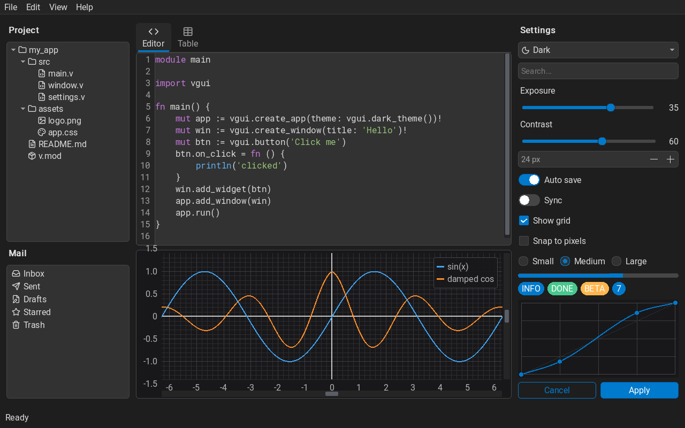
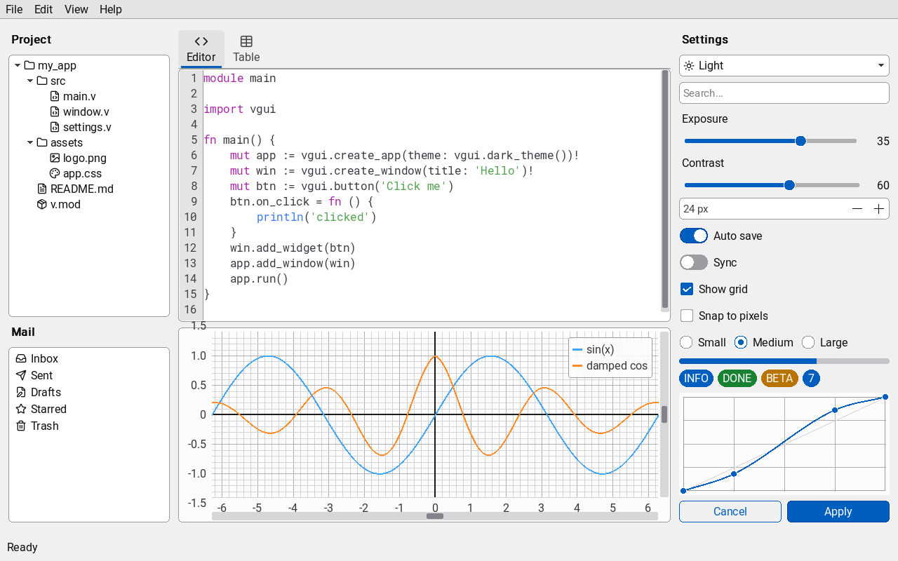
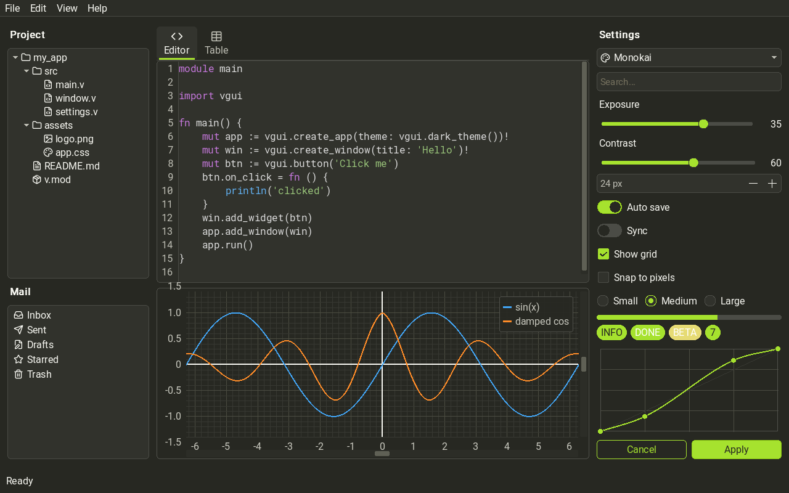

# vgui

[English](README.md) | [Русский](README.ru.md) | [Deutsch](README.de.md) | [Français](README.fr.md) | **Español** | [Italiano](README.it.md) | [Nederlands](README.nl.md) | [Português](README.pt.md) | [Polski](README.pl.md)

Una biblioteca gráfica para el lenguaje [V](https://vlang.io) sobre
[SDL3](https://libsdl.org). vgui dibuja toda la interfaz por sí misma
(sin widgets nativos del sistema), admite HiDPI, temas, animaciones y
traducciones, y solo vuelve a dibujar las partes de la ventana que han
cambiado.



## Funciones

- **Controles** — Label, Button, CheckBox, RadioButton, ToggleSwitch,
  Slider, Spinbox, TextInput, TextArea, ComboBox, Spinner, ProgressBar,
  Badge, DatePicker, ColorPicker, CurveEditor, ShortcutInput.
- **Widgets complejos** — CodeEditor con resaltado de sintaxis,
  MarkdownView, ListBox, TableView (modo virtual para millones de
  filas), TreeView, PropertyGrid, PlotView, Canvas (dibujo con acceso
  directo a los píxeles), ImageView.
- **Contenedores** — VBox/HBox, Panel, Grid, Stack, Centered,
  ScrollBox, TabBox, Accordion, Splitter. Diseño sin píxeles: un widget
  recibe su tamaño natural o una parte del espacio libre (`flex`), con
  `min`, `max` y alineación.
- **Menús y capas superpuestas** — MenuBar con atajos de teclado,
  MenuButton, ContextMenu, información emergente en cualquier widget,
  notificaciones, diálogos modales.
- **Integración con el sistema** — diálogos nativos de archivos y
  carpetas, bandeja del sistema, arrastrar y soltar desde otras
  aplicaciones, ventanas sin borde.
- **Aspecto** — 15 temas integrados (Dark, Light, Monokai,
  Windows 10/11, KDE Breeze, GNOME Adwaita, macOS, Mac OS X Aqua,
  Mac OS 9 Platinum — variantes claras y oscuras), hojas de estilo tipo
  CSS, animaciones, escalado de la interfaz.
- **Todo incluido** — iconos Lucide y fuentes Roboto integrados en el
  binario, traducción de la interfaz (`vgui.i18n`), deshacer/rehacer,
  descripción compacta de interfaces `.vui`.
- **Pruebas** — `testkit.v`: entrada sintética e instantáneas del
  renderizado; las pruebas se ejecutan sin pantalla.

## Capturas de pantalla

La misma ventana ([`examples/59_showcase.v`](examples/59_showcase.v))
con los temas Light y Monokai; el tema se cambia sobre la marcha.





Una aplicación real hecha con vgui es
[vraw](https://github.com/Mintormo/vraw), un revelador de fotos RAW:


## Inicio rápido

```v
module main

import vgui

fn main() {
	mut app := vgui.create_app(theme: vgui.dark_theme())!
	mut win := vgui.create_window(title: 'Hello')!

	mut root := vgui.create_vbox_fill()
	root.set_padding(16)
	root.set_spacing(8)

	mut counter := vgui.label('Clicks: 0')
	mut clicks := 0
	mut btn := vgui.button('Click me')
	btn.on_click = fn [mut counter, mut clicks] () {
		clicks++
		counter.text = 'Clicks: ${clicks}'
	}
	root.add(counter)
	root.add(btn)

	win.add_widget(root)
	app.add_window(win)
	app.run()
}
```

```bash
~/soft/v/v -cc gcc run hello.v
```

`box.add(w)` da al widget su tamaño natural; `box.add(w, flex: 1)`, una
parte del espacio libre; también existen `min:`, `max:` y `align:`.
Una ventana sin tamaño explícito se ajusta a su contenido.

## Compilación y dependencias

vgui es un módulo en código fuente: no hay que compilar nada aparte,
la biblioteca se compila junto con su programa. La plataforma principal
es Linux (probado en Ubuntu 24.04). Los programas para Windows se
compilan de forma cruzada en Linux (así se hace la versión para Windows
de vraw); compilar directamente en Windows con MSYS2 debería funcionar,
pero aún no se ha probado. Hay una rama para macOS, sin probar.

| Componente | Versión | Linux (Ubuntu / Debian / Mint) | Windows (MSYS2, MINGW64) |
|---|---|---|---|
| Compilador V | 0.5.2 (a1c9e93) o posterior | desde el código fuente (paso 3) | desde el código fuente |
| gcc | 13+ | `build-essential` | `mingw-w64-x86_64-gcc` |
| SDL3 | 3.2+ | desde el código fuente (paso 2), aún no está en los repositorios | `mingw-w64-x86_64-sdl3` |
| SDL3_ttf | 3.2+ | desde el código fuente (paso 2) | `mingw-w64-x86_64-sdl3-ttf` |
| SDL3_image | 3.4+ | desde el código fuente (paso 2) | `mingw-w64-x86_64-sdl3-image` |

vgui solo se compila con gcc (`-cc gcc`).

### Linux

**1. Paquetes del sistema** — compilador y bibliotecas con las que se
compila SDL3:

```bash
sudo apt install build-essential git cmake pkg-config \
  libx11-dev libxext-dev libxrandr-dev libxcursor-dev libxfixes-dev \
  libxi-dev libxss-dev libxtst-dev libxkbcommon-dev libwayland-dev \
  libdecor-0-dev libegl1-mesa-dev libgl1-mesa-dev libgles2-mesa-dev \
  libdrm-dev libgbm-dev libdbus-1-dev libibus-1.0-dev libudev-dev \
  libasound2-dev libpulse-dev libpipewire-0.3-dev \
  libfreetype-dev libharfbuzz-dev libpng-dev libjpeg-dev libwebp-dev libtiff-dev
```

En Fedora, Arch y otras distribuciones instale las mismas bibliotecas
con su gestor de paquetes. Si ya incluye SDL3, SDL3_ttf y SDL3_image 3.4
o posterior (con paquetes `-devel`/`-dev`), omita el paso 2.

**2. SDL3, SDL3_ttf, SDL3_image** — compiladas desde el código fuente e
instaladas en `/usr/local`:

```bash
mkdir -p ~/src && cd ~/src
for repo in SDL SDL_ttf SDL_image; do
  git clone --depth 1 https://github.com/libsdl-org/$repo
  cmake -S $repo -B $repo/build -DCMAKE_BUILD_TYPE=Release
  cmake --build $repo/build -j"$(nproc)"
  sudo cmake --install $repo/build
done
sudo ldconfig
```

**3. Compilador V:**

```bash
git clone https://github.com/vlang/v ~/soft/v
cd ~/soft/v && make
```

**4. vgui.** La raíz del repositorio es el propio módulo `vgui`; V lo
encuentra a través de `~/.vmodules`:

```bash
mkdir -p ~/.vmodules ~/projects
git clone https://github.com/Mintormo/vgui ~/projects/vgui
ln -s ~/projects/vgui ~/.vmodules/vgui
cd ~/projects/vgui
~/soft/v/v -cc gcc run examples/59_showcase.v
```

### Windows

**Compilación cruzada en Linux.** Instale MinGW-w64
(`sudo apt install gcc-mingw-w64-x86-64`) y coloque las versiones para
Windows de SDL3, SDL3_ttf y SDL3_image (cabeceras, bibliotecas de
importación y DLL de los paquetes MSYS2 `mingw64`) en un prefijo, por
ejemplo `~/soft/mingw64`. Después:

```bash
pfx=~/soft/mingw64
~/soft/v/v -os windows -cc x86_64-w64-mingw32-gcc-posix -subsystem windows \
  -cflags "-I$pfx/include" -ldflags "-L$pfx/lib" -o app.exe app.v
```

Coloque junto al exe las DLL de `$pfx/bin` que necesita. Un ejemplo
completo que funciona — descarga de los paquetes MSYS2
(`tools/win_deps.py`) y recopilación de las DLL (`tools/windows.sh`) —
está en el repositorio [vraw](https://github.com/Mintormo/vraw).

**Directamente en MSYS2 (aún no probado).** Instale
[MSYS2](https://www.msys2.org), abra la terminal **MSYS2 MINGW64** y
ejecute:

```bash
pacman -S --needed git make mingw-w64-x86_64-gcc \
  mingw-w64-x86_64-sdl3 mingw-w64-x86_64-sdl3-ttf mingw-w64-x86_64-sdl3-image
git clone https://github.com/vlang/v ~/v
(cd ~/v && make)
mkdir -p "$USERPROFILE/.vmodules"
git clone https://github.com/Mintormo/vgui "$USERPROFILE/.vmodules/vgui"
cd "$USERPROFILE/.vmodules/vgui" && ~/v/v -cc gcc run examples/59_showcase.v
```

## Ejemplos

[`examples/`](examples) contiene 58 pequeños programas, uno por widget o
función (su interfaz está en ruso), además de
[`59_showcase.v`](examples/59_showcase.v) con todo en una ventana.

```bash
~/soft/v/v -cc gcc run examples/01_label.v    # un ejemplo
PATH=~/soft/v:$PATH examples/build.sh          # compilar todos en examples/bin/
```

## Pruebas

```bash
SDL_VIDEODRIVER=dummy ~/soft/v/v -cc gcc test .
```

No hace falta pantalla: SDL funciona con el controlador `dummy`.

## Documentación

El código está comentado en detalle: cada archivo empieza con una
cabecera que lo describe. Las notas de diseño están en ruso:
[PROJECT.md](PROJECT.md) — cómo funciona cada subsistema (diseño,
invalidación, renderizado, foco, capas, hilos, temas, i18n) y por qué,
[ROADMAP.md](ROADMAP.md) — el plan de desarrollo,
[docs/](docs) — auditorías y revisiones.

## Hecho con Claude Code

vgui se creó con vibe coding: escrita junto con
[Claude Code](https://claude.com/claude-code), el asistente de
programación con IA de Anthropic.

## Licencia

[MIT](LICENSE). Los recursos de terceros en `assets/` se rigen por sus
propias licencias: fuentes Roboto — Apache License 2.0, fuentes
DejaVu — licencia Bitstream Vera, iconos Lucide — ISC.
